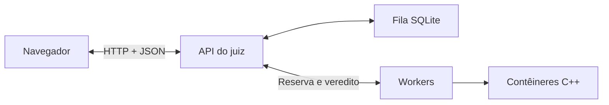

# Mini Juiz Online Distribuído

Protótipo de uma competição de programação com submissões em C++17. A arena oferece três problemas, recebe código pelo editor ou por arquivo `.cpp` e acompanha a fila, os vereditos e o trabalho dos workers em uma central lateral de correção.

## Arena de maratona

| Problema | Tema | Solução de exemplo |
|---|---|---|
| A · Soma de dois números | Aritmética | `examples/soma.cpp` |
| B · Maior elemento | Vetores | `examples/maior.cpp` |
| C · Parênteses balanceados | Strings e pilhas | `examples/parenteses.cpp` |

Selecione A, B ou C no caderno de problemas. Cada problema possui enunciado, exemplo, limites e casos de teste próprios. Ao alternar entre problemas, o editor mantém um rascunho separado durante a sessão da página.

A central de correção mostra a fila de execução, a equipe e o problema atribuídos a cada worker, a compilação e quantos casos de teste já foram executados. O histórico identifica o problema de cada submissão. As atualizações vêm da API; não há workers simulados nem porcentagem fictícia de compilação. No celular, a central aparece abaixo da arena.

Os workers enviam progresso nas renovações da reserva, pelos campos `phase`, `testsCompleted` e `testsTotal`. A API impede atualizações de reservas expiradas e a retomada reinicia o progresso. Bancos SQLite existentes recebem as novas colunas sem apagar submissões. Ao atualizar uma instalação, reconstrua a API e reinicie os workers para habilitar o progresso detalhado.

## Editor de código

O editor usa CodeMirror 6 com suporte a C++, tema claro, números de linha, cores de sintaxe, fechamento de delimitadores, indentação automática e autocomplete local para palavras reservadas, funções comuns, nomes do documento e trechos como `for`, `if` e `while`. Cada problema começa com o template C++ padrão e mantém seu código, seleção e histórico de edição separados durante a sessão. As sugestões não fazem análise semântica do compilador; os erros de compilação continuam sendo informados pelo juiz após o envio.

| Atalho | Ação |
|---|---|
| `Tab` / `Shift+Tab` | Indentar com quatro espaços / recuar; avançar ou voltar entre campos de um trecho |
| `Ctrl+Espaço` | Abrir sugestões; aceitar com Enter ou Tab |
| `Enter` | Nova linha com indentação automática |
| `Ctrl+Z` / `Ctrl+Y` | Desfazer / refazer (no macOS, `Cmd+Z` / `Cmd+Shift+Z`) |
| `Ctrl+F` | Buscar no código (no macOS, `Cmd+F`) |
| `Esc`, depois `Tab` | Sair do editor usando o teclado |

O bundle `public/editor.js` e suas licenças estão incluídos no projeto. A execução normal e o Docker não precisam baixar bibliotecas do editor. Para alterar `src/editor.mjs` e regenerar o bundle, execute `npm ci` e `npm run build:editor`. A geração também atualiza `public/editor-LICENSE.txt`.

Para testar os atalhos reais, sugestões, cores, rascunhos, upload, envio e responsividade no Chrome headless, execute `npm run test:editor` na raiz do projeto. O script usa uma API temporária em memória e detecta o Chrome em `/usr/bin/google-chrome`; em outros sistemas, defina `CHROME_BIN` com o caminho do executável. Se o editor avançado não carregar, a página oferece o campo de texto básico para continuar enviando soluções.

## Executar no Windows

Abra o Docker Desktop com o motor Linux ativo. Tenha o Node.js 24 instalado e execute os comandos na pasta do projeto.

**Terminal 1 · API e interface**

```powershell
docker build -t minijuiz-runner:local ./runner
docker compose up --build
```

**Iniciar os dois workers**

```powershell
.\start-workers.cmd
```

O script abre um terminal para o `worker-1` e outro para o `worker-2`. Também pode ser iniciado com dois cliques. Para interromper um worker, pressione `Ctrl+C` no terminal correspondente.

Abra [localhost:3000](http://localhost:3000), preencha o nome do participante e envie `examples/soma.cpp`. O arquivo tem uma pausa curta por caso para dar tempo de acompanhar a correção no painel.

Para desenvolver a interface ou consultar a fila com a API fora do Docker, execute `node src/server.mjs`. Essa opção guarda as submissões em `data/judge.sqlite`. A opção com Compose usa um volume Docker próprio. Use um modo de API por vez para evitar conflito na porta 3000.

## Demonstração no laboratório

1. Envie duas cópias de `examples/soma.cpp` e mostre os dois workers em correção.
2. Envie mais uma submissão. Quando ela aparecer como **Em correção**, encerre o worker correspondente com `Ctrl+C`.
3. Acompanhe a tarefa voltar à fila após a expiração da reserva. O worker disponível assume a correção e a interface exibe `Accepted` com **2 tentativas**.
4. Reinicie o worker interrompido e mostre seu retorno ao painel.

Para distribuir a execução em **dois computadores**, mantenha a API no primeiro e rode pelo menos um worker no segundo. Em ambos, construa a imagem do runner. Use uma rede de laboratório confiável. No terminal da API, defina `$env:BIND_ADDRESS = '0.0.0.0'` antes de `docker compose up --build`. Defina também um `JUDGE_TOKEN` próprio no terminal da API e nos terminais dos workers. No worker remoto, defina `$env:API_URL = 'http://IP_DA_MAQUINA_DA_API:3000'`. O navegador das duas máquinas pode acessar esse mesmo endereço. O token de desenvolvimento padrão atende ao cenário local.

## Deploy na Vercel (com banco Turso)

A interface e a API podem ser hospedadas na Vercel usando um banco **Turso (libSQL)**, enquanto os workers C++ com Docker rodam na sua máquina ou em uma VPS.

### 1. Configurar Turso e Vercel

1. Crie um banco no [Turso](https://turso.tech) e copie a **Database URL** (`libsql://...`) e o **Auth Token**.
2. Importe este repositório na Vercel com **Application Preset** em `Other` (o [vercel.json](vercel.json) serve `public/` e direciona `/api/*` e `/internal/*` para `api/index.mjs`).
3. Configure as variáveis de ambiente na Vercel (veja `.env.example`):
   - `TURSO_DATABASE_URL`: URL `libsql://...` do banco Turso
   - `TURSO_AUTH_TOKEN`: token de acesso do Turso
   - `JUDGE_TOKEN`: segredo compartilhado com os workers
   - `LEASE_MS`: `10000` *(opcional)*
   - `MAX_ATTEMPTS`: `3` *(opcional, limite antes de `dead_letter`)*

### 2. Conectar workers e roteiro da demonstração de Sistemas Distribuídos

Com o Docker Desktop ativo e a imagem do runner construída (`docker build -t minijuiz-runner:local ./runner`), inicie os workers no PowerShell apontando para a URL da Vercel:

```powershell
$env:API_URL = "https://SEU-PROJETO.vercel.app"
$env:JUDGE_TOKEN = "SEU-JUDGE-TOKEN-DA-VERCEL"
.\start-workers.cmd
```

1. **Concorrência e balanceamento de carga:** abra a URL da Vercel, confirme que `worker-1` e `worker-2` aparecem como **Disponível** e clique em **Simular rajada (6 tarefas)** na seção **Sistemas Distribuídos · Protocolo ao vivo**. Mostre os workers reservando tarefas atomicamente sem duplicação e os eventos `submitted` / `claimed` / `finished` na linha do tempo.
2. **Falha crash-stop + TTL ao vivo:** envie `examples/soma.cpp` no Problema A. Assim que a tarefa entrar **Em correção**, acompanhe a barra de **TTL** (10 s) no card do worker e pressione `Ctrl+C` na janela dele. Quando o TTL zerar, mostre o evento `Retomada` (`reclaimed`), o outro worker concluindo com **2 tentativas** e o contador de retomadas subindo.
3. **Worker atrasado / Fencing token (`409`):** abra um terminal extra com atraso simulado antes do `finish` (maior que `LEASE_MS`):
   ```powershell
   $env:API_URL = "https://SEU-PROJETO.vercel.app"
   $env:JUDGE_TOKEN = "SEU-JUDGE-TOKEN-DA-VERCEL"
   $env:WORKER_ID = "worker-lento"
   $env:SIMULATE_STALE_MS = "13000"
   node src\worker.mjs
   ```
   Envie uma submissão: quando o `worker-lento` segurar o resultado, o lease expira, outro worker normal retoma e conclui, e ao acordar o `worker-lento` recebe **HTTP `409`** — registrado ao vivo como **Rejeitada (409)** na linha do tempo e no contador de rejeições.
4. **Proteção Dead-letter:** se uma tarefa expirar `MAX_ATTEMPTS` vezes consecutivas (padrão 3), a API a promove para **Dead Letter** em vez de reprocessá-la infinitamente.

## Arquitetura



| Conceito | Aplicação no protótipo |
|---|---|
| Comunicação entre processos | Navegador e workers se comunicam com a API por HTTP. O envio de uma submissão devolve seu identificador imediatamente. |
| Web Services | A API JSON aceita submissões, expõe o painel e oferece operações autenticadas para os workers. |
| Sincronização | Uma atualização atômica reserva a tarefa para um worker. Reservas duram 10 segundos e são renovadas durante a correção. |
| Recuperação após falha | Uma tarefa com reserva expirada volta a ficar disponível. A API rejeita vereditos de reservas anteriores e trata a repetição do mesmo resultado de forma idempotente. |
| Contêineres | A API pode rodar em Docker. Cada compilação e cada caso de teste usam contêineres descartáveis com limites de recursos e rede desativada. |

A API é o coordenador único deste marco. A recuperação demonstrada é a falha de um **worker**. O armazenamento SQLite persiste a fila e os vereditos entre reinícios da API. O protótipo é voltado ao laboratório, com submissões de demonstração. Para hospedagem pública com código não confiável, a fronteira de execução precisaria de isolamento adicional.

## Testes

```powershell
node --test
```

O teste de integração disputa a mesma tarefa entre dois consumidores, espera a expiração e verifica a retomada e a rejeição do resultado atrasado. Para testar também o executor Docker, construa a imagem e execute:

```powershell
$env:TEST_DOCKER = '1'
node --test
```

O próximo marco é acrescentar o placar no estilo ICPC. Uma etapa de orquestração com Kubernetes pode reaproveitar o protocolo de reserva e envio de resultados.
