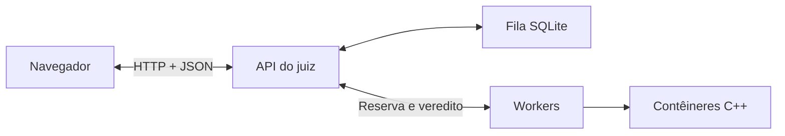

# Mini Juiz Online Distribuído

Protótipo de uma competição de programação com submissões em C++17. A interface exibe um problema, recebe código pelo editor ou por arquivo `.cpp` e acompanha a fila, os vereditos e os workers.

## Executar no Windows

Abra o Docker Desktop com o motor Linux ativo. Tenha o Node.js 24 instalado e execute os comandos na pasta do projeto.

**Terminal 1 · API e interface**

```powershell
docker build -t minijuiz-runner:local ./runner
docker compose up --build
```

**Iniciar os dois workers**

```powershell
.\start-workers.cmd
```

O script abre um terminal para o `worker-1` e outro para o `worker-2`. Também pode ser iniciado com dois cliques. Para interromper um worker, pressione `Ctrl+C` no terminal correspondente.

Abra [localhost:3000](http://localhost:3000), preencha o nome do participante e envie `examples/soma.cpp`. O arquivo tem uma pausa curta por caso para dar tempo de acompanhar a correção no painel.

Para desenvolver a interface ou consultar a fila com a API fora do Docker, execute `node src/server.mjs`. Essa opção guarda as submissões em `data/judge.sqlite`. A opção com Compose usa um volume Docker próprio. Use um modo de API por vez para evitar conflito na porta 3000.

## Demonstração no laboratório

1. Envie duas cópias de `examples/soma.cpp` e mostre os dois workers em correção.
2. Envie mais uma submissão. Quando ela aparecer como **Em correção**, encerre o worker correspondente com `Ctrl+C`.
3. Acompanhe a tarefa voltar à fila após a expiração da reserva. O worker disponível assume a correção e a interface exibe `Accepted` com **2 tentativas**.
4. Reinicie o worker interrompido e mostre seu retorno ao painel.

Para distribuir a execução em **dois computadores**, mantenha a API no primeiro e rode pelo menos um worker no segundo. Em ambos, construa a imagem do runner. Use uma rede de laboratório confiável. No terminal da API, defina `$env:BIND_ADDRESS = '0.0.0.0'` antes de `docker compose up --build`. Defina também um `JUDGE_TOKEN` próprio no terminal da API e nos terminais dos workers. No worker remoto, defina `$env:API_URL = 'http://IP_DA_MAQUINA_DA_API:3000'`. O navegador das duas máquinas pode acessar esse mesmo endereço. O token de desenvolvimento padrão atende ao cenário local.

## Arquitetura



| Conceito | Aplicação no protótipo |
|---|---|
| Comunicação entre processos | Navegador e workers se comunicam com a API por HTTP. O envio de uma submissão devolve seu identificador imediatamente. |
| Web Services | A API JSON aceita submissões, expõe o painel e oferece operações autenticadas para os workers. |
| Sincronização | Uma atualização atômica reserva a tarefa para um worker. Reservas duram 10 segundos e são renovadas durante a correção. |
| Recuperação após falha | Uma tarefa com reserva expirada volta a ficar disponível. A API rejeita vereditos de reservas anteriores e trata a repetição do mesmo resultado de forma idempotente. |
| Contêineres | A API pode rodar em Docker. Cada compilação e cada caso de teste usam contêineres descartáveis com limites de recursos e rede desativada. |

A API é o coordenador único deste marco. A recuperação demonstrada é a falha de um **worker**. O armazenamento SQLite persiste a fila e os vereditos entre reinícios da API. O protótipo é voltado ao laboratório, com submissões de demonstração. Para hospedagem pública com código não confiável, a fronteira de execução precisaria de isolamento adicional.

## Testes

```powershell
node --test
```

O teste de integração disputa a mesma tarefa entre dois consumidores, espera a expiração e verifica a retomada e a rejeição do resultado atrasado. Para testar também o executor Docker, construa a imagem e execute:

```powershell
$env:TEST_DOCKER = '1'
node --test
```

O próximo marco é acrescentar problemas B e C e o placar no estilo ICPC. Uma etapa de orquestração com Kubernetes pode reaproveitar o protocolo de reserva e envio de resultados.
